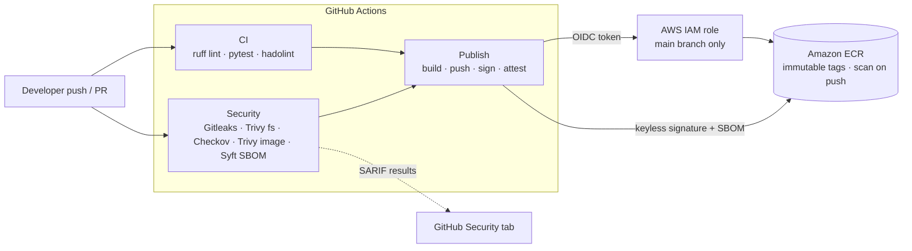

# DevSecOps CI/CD Pipeline

[](https://github.com/nasir-mahmood/devsecops-cicd-pipeline/actions/workflows/release.yml)
[](LICENSE)

A secure software delivery pipeline built with **GitHub Actions**. Every change
is linted, tested and scanned for secrets, vulnerable dependencies,
misconfigured infrastructure and vulnerable container images **before** it can
be released. Released images are pushed to **Amazon ECR** using **GitHub OIDC**
(no stored AWS keys), **signed with Cosign** and shipped with a signed
**SBOM**.

The application itself is deliberately tiny (a two-endpoint FastAPI service).
The point of this repository is the pipeline around it.

---

## Table of contents

- [Why this project](#why-this-project)
- [Architecture](#architecture)
- [Pipeline stages](#pipeline-stages)
- [Repository structure](#repository-structure)
- [Run it locally](#run-it-locally)
- [Enable the release to AWS (optional)](#enable-the-release-to-aws-optional)
- [Verify a released image](#verify-a-released-image)
- [Design decisions](#design-decisions)
- [Cost](#cost)
- [What I would add next](#what-i-would-add-next)

---

## Why this project

Most pipelines check that code **works**. Fewer check that it is **safe to
ship**. This pipeline treats security as a gate, not a report:

- A leaked secret, a fixable HIGH/CRITICAL vulnerability or an insecure
  Terraform or Dockerfile setting **stops the release**.
- Cloud access uses **short-lived OIDC tokens** scoped to one repository and
  one branch. There are no AWS keys in GitHub.
- Every released image is **signed** and has a **software bill of materials**,
  so anyone can verify what is running and where it came from.

## Architecture



## Pipeline stages

| Stage | Workflow | Tools | Fails the build when |
|---|---|---|---|
| Lint | `ci.yml` | Ruff | Python style or logic issues |
| Unit tests | `ci.yml` | Pytest | Any test fails |
| Dockerfile lint | `ci.yml` | Hadolint | Dockerfile breaks best practices |
| Secret scan | `security.yml` | Gitleaks | A secret is found in the code or Git history |
| Dependency scan | `security.yml` | Trivy (filesystem) | A HIGH/CRITICAL vulnerability with a fix exists |
| IaC scan | `security.yml` | Checkov | Terraform or Dockerfile misconfiguration |
| Image scan | `security.yml` | Trivy (image) | A HIGH/CRITICAL vulnerability with a fix exists |
| SBOM | `security.yml` | Syft (SPDX JSON) | Never, informational |
| Publish | `release.yml` | Docker Buildx, ECR | Push fails |
| Sign + attest | `release.yml` | Cosign (keyless, Sigstore) | Signing fails |

**When each workflow runs**

- **Pull request:** CI and Security run, so problems are caught before merge.
- **Push to `main`:** `release.yml` reuses CI and Security as jobs, and the
  publish job starts only if both pass.
- **Every Monday:** Security runs again to catch newly published CVEs in code
  that has not changed.

Scan results are uploaded in SARIF format and appear under the repository's
**Security → Code scanning** tab.

## Repository structure

```
.
├── app/                    FastAPI service (2 endpoints)
├── tests/                  Pytest unit tests
├── Dockerfile              Multi-stage, non-root user, health check
├── requirements*.txt       Pinned dependencies
├── Makefile                Common local commands
├── terraform/              ECR repository + GitHub OIDC role (least privilege)
├── .github/
│   ├── workflows/
│   │   ├── ci.yml          Lint, tests, Dockerfile lint
│   │   ├── security.yml    Secret, dependency, IaC and image scans + SBOM
│   │   └── release.yml     Full pipeline on main: CI + Security → publish
│   └── dependabot.yml      Weekly updates for pip, Docker, Actions, Terraform
├── docs/decisions.md       Why the pipeline is built this way
└── SECURITY.md             Security controls and how to report issues
```

## Run it locally

Requirements: Python 3.12 and Docker. Trivy is optional.

```bash
make install   # install dev dependencies
make lint      # ruff
make test      # pytest
make run       # build the image and serve it on http://localhost:8000
make scan      # scan the image with Trivy (if installed)
```

Then open `http://localhost:8000/health`, which returns `{"status": "ok"}`.

## Enable the release to AWS (optional)

The pipeline is green without AWS. The publish job is skipped until you set
one repository variable. To turn it on:

1. **Create the AWS resources** (ECR repository + OIDC role):

   ```bash
   cd terraform
   terraform init
   terraform apply -var="github_repository=nasir-mahmood/devsecops-cicd-pipeline"
   ```

   If your AWS account already has the GitHub OIDC provider, add
   `-var="create_oidc_provider=false"`.

2. **Copy the role ARN** from the output `aws_role_arn`.

3. **Add repository variables** in GitHub under
   *Settings → Secrets and variables → Actions → Variables*:

   | Variable | Example | Required |
   |---|---|---|
   | `AWS_ROLE_ARN` | `arn:aws:iam::123456789012:role/github-release-devsecops-demo` | Yes |
   | `AWS_REGION` | `us-east-1` | No, defaults to `us-east-1` |
   | `ECR_REPOSITORY` | `devsecops-demo` | No, defaults to `devsecops-demo` |

These are **variables, not secrets**: a role ARN is not sensitive because only
this repository's `main` branch can assume it.

**What the IAM role can do:** log in to ECR and push images to this one
repository. Nothing else.

**Clean up:** `terraform destroy` removes everything. If the repository still
contains images, delete them first or empty the repository in the console.

## Verify a released image

Anyone can check that an image was built by this repository's pipeline:

```bash
IMAGE=<account>.dkr.ecr.<region>.amazonaws.com/devsecops-demo@sha256:<digest>

cosign verify "$IMAGE" \
  --certificate-identity-regexp "https://github.com/nasir-mahmood/devsecops-cicd-pipeline/" \
  --certificate-oidc-issuer https://token.actions.githubusercontent.com

cosign verify-attestation "$IMAGE" --type spdxjson \
  --certificate-identity-regexp "https://github.com/nasir-mahmood/devsecops-cicd-pipeline/" \
  --certificate-oidc-issuer https://token.actions.githubusercontent.com
```

## Design decisions

Short version below; details in [docs/decisions.md](docs/decisions.md).

| Decision | Reason |
|---|---|
| GitHub OIDC instead of AWS keys | No long-lived secrets to leak or rotate |
| Trust policy limited to `main` of one repo | A fork or feature branch cannot push images |
| Security as a required gate | Vulnerable builds never reach the registry |
| Fail only on fixable HIGH/CRITICAL | Avoids blocking on CVEs nobody can patch yet |
| Immutable ECR tags, signed by digest | A tag cannot be overwritten; the signature matches exactly what was built |
| Multi-stage, non-root image | Smaller attack surface, no build tools at runtime |
| Release job is optional | Anyone can fork and get a green pipeline |

## Cost

- **GitHub Actions:** free for public repositories.
- **AWS (only if you enable the release):** ECR storage is a few cents per
  month for this image size. The lifecycle policy keeps only the last 20
  images. IAM and OIDC are free.

## What I would add next

- Deploy the signed image to Kubernetes and **enforce signature verification**
  at admission (Kyverno or Sigstore policy-controller).
- **DAST** with OWASP ZAP against a preview environment.
- **SLSA provenance** attestation for build integrity.
- Branch protection rules requiring the Security checks to pass before merge.

---

**Author:** Nasir Mahmood · Senior Cloud & DevOps Engineer ·
[LinkedIn](https://www.linkedin.com/in/nasir-mahmood) ·
[GitHub](https://github.com/nasir-mahmood)

Licensed under the [MIT License](LICENSE).
